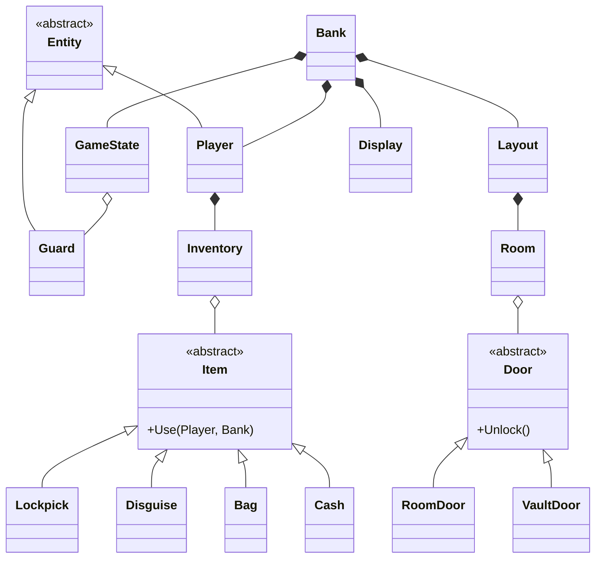

# Bank-Heist-OOP-Game

## Overview

The Bank is a turn-based, text-only game written in C#. You play a thief who breaks into a bank, collects as much loot as possible and returns to the street without being caught by a guard.

I built it to strengthen my understanding of object-oriented programming. I wanted to use inheritance, abstraction, encapsulation and polymorphism together in a project that was complete but small enough to finish, rather than practising each concept in isolation. The aim was to develop fluency with these ideas, so the game itself is deliberately simple.

## Project scale

- **Language:** C#
- **Framework:** .NET 6 or later
- **Classes:** 28, including 3 abstract classes
- **Source code:** Approximately 1,040 lines
- **External libraries:** None; uses the .NET standard libraries.

## Running the game

The code uses implicit usings and nullable reference types, so it requires .NET 6 or later. From the project folder, run:

```bash
git clone https://github.com/qila-09/Bank-Heist-OOP-Game.git
cd Bank-Heist-OOP-Game
dotnet run
```

The game clears and redraws the console every turn, so it should be run in a normal terminal window.

## Architecture

### Class overview

The program is divided into classes according to their responsibilities.



`Cash` stands in for the other loot classes (`Gold`, `Watch`, `Necklace`, `Bonds`, `HardDrive`, `Painting` and `Copper`), which mainly define a name, value and whether they fit in a bag. `EmptySlot` and `VaultCode` are also subclasses of `Item`.

### Core loop

`Bank` coordinates each turn in a fixed order:

1. Update every guard's position for the current turn.
2. Render the display.
3. Check whether any guard has found the player.
4. Process the player's actions until they move or end the heist.
5. Expire the player's disguise if its two turns are up.
6. Move on to the next turn.

The loop repeats until the player wins, is caught or types `quit`.

A turn only passes when the player walks to another room. Taking, dropping and using items are free actions, so a disguise's two turns refer to two moves.

### Rooms and doors

`Layout` builds every `Room` when the game starts and connects them using `Door` objects. This represents the bank as a graph of rooms rather than a grid.

`CreateDoor` has a `reverse` parameter that creates the matching door in the other room, so every connection works in both directions without having to define it twice. `Unlock` also unlocks the corresponding door on the other side, ensuring that both ends remain consistent.

Every door is a `RoomDoor`, apart from the one between the Safe Deposit Room and the Vault, which is a `VaultDoor`. A `VaultDoor` cannot be lockpicked and instead requires a four-digit code. This code is randomly generated each game and placed in the Security Room.

### Entities and guards

`Player` and `Guard` both inherit from `Entity`, which stores their position in the bank.

Each guard is given a fixed list of rooms when it is created. Its position on turn `t` is determined using:

```csharp
path[t % path.Count]
```

This uses modular arithmetic to cycle through the guard's route indefinitely. Because the route is fixed, `NextPos` can calculate where a guard will be on the following turn. This is used to produce the `[GUARD NEXT]` warning displayed beside doors.

At the start of each turn, every guard checks whether it is in the same room as the player. If that room is restricted and the player has no disguise, the game ends.

### Items and inventory

All items inherit from `Item`, which stores a name, value, whether it fits in a bag and its number of uses. A use count of `-1` represents an item that is never consumed.

The player starts with two inventory slots, and picking up the `Bag` adds six more. The `Painting` does not fit in the bag, so it must be carried in a main inventory slot.

The take displayed at the top of the screen adds up the value of the player's inventory, the bag and anything left on the street. A bag left on the street also counts along with its contents.

### Rendering

`Display` builds the whole interface as a string. This includes the current room, its items, its doors (with locked status and guard warnings), the inventory and the available actions.

## OOP concepts used

- **Inheritance:** `Entity` is the base class for `Player` and `Guard`, `Item` is the base class for every item, and `Door` is the base class for `RoomDoor` and `VaultDoor`. Shared functionality is implemented in the base classes, reducing repeated code.

- **Polymorphism:** `Item.Use()` is a virtual method. `Lockpick` and `Disguise` override it with their own behaviour, while other items use the base implementation, which reports that the item has no use. `Player.UseItem` can therefore call `Use` on any item without checking its specific type.

- **Abstraction:** `Entity`, `Item` and `Door` are abstract classes. They cannot be instantiated directly and instead define common properties and behaviour for their subclasses.

- **Encapsulation:** Fields are generally private and accessed through methods and getters. For example, `Inventory.Add` and `Inventory.Drop` check whether slots are available before modifying the inventory. This is not applied consistently throughout the program: `Bank.bag` and `Bank.turn` are public fields, and some getters return references to internal lists and arrays.

- **Composition:** `Bank` brings together a `Layout`, a `GameState`, a `Display` and a `Player`. `Layout` contains the rooms, while each `Room` maintains its doors and items.

## Data structures

- **`List<Room>`:** Stores the sequence of rooms in each guard's patrol route. This allows guards to follow a repeating sequence of locations.

- **`List<Door>`:** Stores the doors connected to each room, allowing the room graph to be constructed and traversed.

- **`List<Item>`:** Stores the items currently present in each room. Items can be added and removed as the player collects or drops them.

- **`List<Guard>`:** Stores the guards managed by `GameState`, allowing their positions to be updated and checked each turn.

- **`Item[]`:** Represents the player's inventory and bag. Fixed-size arrays are suitable because both have a set capacity: two main inventory slots and six bag slots.

These structures allow the game to manage rooms, connections, guards and items without needing to use fixed-size collections everywhere.

## Interesting implementation details

- **Bidirectional room connections:** `CreateDoor` creates a connection between two rooms and automatically creates the corresponding connection in the other room. This avoids duplicating the connection setup and keeps the room graph consistent.

- **Repeating guard routes:** Modular arithmetic determines each guard's position within its patrol route. It also allows the program to calculate the next position in advance, providing the player with warnings about upcoming guard movements.

- **Inventory management:** The inventory and bag use fixed-size arrays with `EmptySlot` objects to represent available spaces. This makes it possible to check for free slots and manage items without resizing the collections.

- **Item behaviour:** Virtual methods allow different item types to implement their own behaviour while remaining accessible through a common `Item` interface.

- **Random vault code:** A four-digit code is generated at the beginning of each game and stored in the Security Room. The vault door checks the entered code before allowing the player to unlock it.

## Design decisions

- **Rooms as a graph:** A graph with two-way doors makes it straightforward to add rooms or locked connections without changing unrelated parts of the program.

- **Fixed guard routes:** Random guard movements could make some games unfair. Fixed routes, combined with the `[GUARD NEXT]` warning, turn the game into a planning puzzle where the player can anticipate guard movements.

- **Setup separated from game logic:** All room, door and item placement is handled by `Layout`, while guard routes are defined in `GameState`. This means that changing the map does not require modifying `Bank` or `Player`.

## Limitations

- `Player.Action` reads console input directly, so the entity class is coupled to the user interface. I would move input handling into a separate controller class.

- `Display.Render` clears the console and returns a string. Building the text and drawing it should be separate steps.

- Guard routes are not checked against the door graph, so some patrols jump between rooms that are not directly connected. For example, the Server Room and Counting Room only connect through the Landing.

- The layout and loot are hard-coded, so the only thing that changes between games is the vault code. I would introduce randomly generated layouts or item placements to improve replayability.

- Some values, such as the width of the interface, are written directly in the code instead of being named constants.

---

# Gameplay

Play as a thief attempting to rob a bank, moving through rooms, collecting items and avoiding guards. The game ends when you return to the street and finish the heist, or when a guard catches you in a restricted area.

## Controls

| Input  | Action                                 |
| ------ | -------------------------------------- |
| `W`    | Walk: move to another room             |
| `T`    | Take an item from the room             |
| `D`    | Drop an item                           |
| `U`    | Use an item from your inventory or bag |
| `E`    | End the heist (must be on the street)  |
| `quit` | Quit the game immediately              |

## Rules

- **Restricted areas:** Every room past the Main Entrance and the Lobby is restricted. If a guard is in the same restricted room as you and you have no disguise, you are caught and the game ends.
- **Safe rooms:** Guards never enter the Storage Room, the Electrical Room, the Teller Station, the Elevator, either stairwell or the Vault.
- **Guard uniforms:** A uniform lets you share a room with a guard for two turns. A new one can be equipped on the turn the current one expires, when the interface shows **0 turns left**.
- **Lockpicks:** Each lockpick can unlock two doors before it is discarded.
- **The vault:** It has no key and needs a four-digit code. The code is randomly generated each game and kept in the Security Room, where it can be picked up and carried like any other item.
- **Score:** Everything in your inventory, your bag and on the street counts towards your take, which is shown in the top right of the screen.
- **Winning:** Return to the street and enter `E` to finish the heist. Your final take includes the value of everything in your inventory, bag and anything left on the street.

## Map

```text
Street
  └── Main Entrance
        └── Lobby
              ├── Teller Station
              ├── Hall
              │     ├── Office
              │     │     ├── Safe Deposit Room
              │     │     │     └── Vault  ← requires code
              │     │     └── Elevator
              │     │           └── Landing (Upper Floor)
              │     │                 ├── Manager's Office
              │     │                 ├── Server Room
              │     │                 ├── Electrical
              │     │                 └── Counting Room
              │     ├── Board Room
              │     ├── Break Room
              │     │     ├── Security Room  ← vault code is here
              │     │     └── Storage Room
              │     └── Stairwell (Down → Up → Landing)
              └── Office
```

Locked doors are marked in the game, and each room contains a set of items.

## Items

| Item          |  Value | Fits in bag | Notes                                |
| ------------- | -----: | ----------- | ------------------------------------ |
| Cash          |   £100 | Yes         |                                      |
| Watch         |   £250 | Yes         |                                      |
| Necklace      |   £500 | Yes         |                                      |
| Gold Bar      | £1,000 | Yes         |                                      |
| Bonds         | £1,000 | Yes         |                                      |
| Hard Drive    | £1,500 | Yes         |                                      |
| Painting      | £7,500 | **No**      | Must be carried in an inventory slot |
| Copper Wire   |    £10 | Yes         |                                      |
| Guard Uniform |    n/a | Yes         | Disguise, lasts 2 turns              |
| Lockpick      |    n/a | Yes         | Unlocks doors, 2 uses                |
| Vault Code    |    n/a | Yes         | Needed to open the vault             |
| Bag           |    n/a | No          | Carries up to 6 items                |

## Inventory

You start with two inventory slots. The bag is waiting on the street at the start of the game with a guard uniform already inside, and picking it up adds six more slots. When taking or dropping items, you choose between your inventory and your bag. The painting cannot go in the bag.

## Guards

Guards patrol the bank along fixed routes, moving once per turn. When you are choosing which door to walk through, any room a guard will be in on the next turn is marked **[GUARD NEXT]**.

## Tips

- Check the door list for **[GUARD NEXT]** before every move.
- The vault code changes every game, so find it before you go to the vault.
- Items left on the street still count towards your take, so you can drop loot there and go back in for more.
- Lockpicks and uniforms are limited and do not regenerate, so use them carefully.
